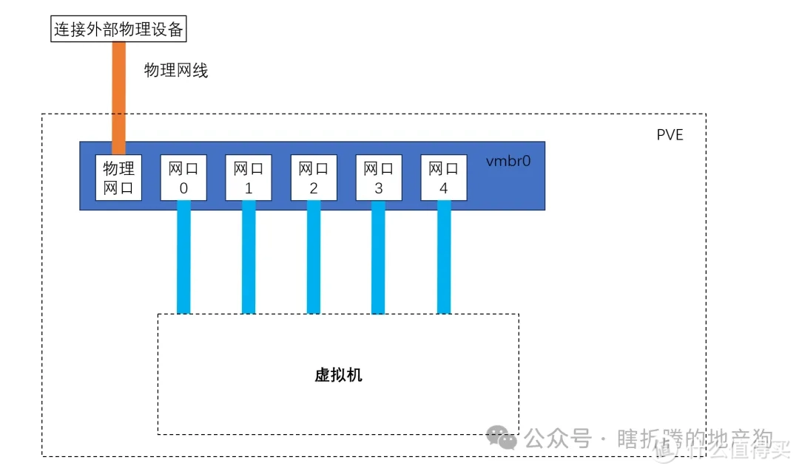
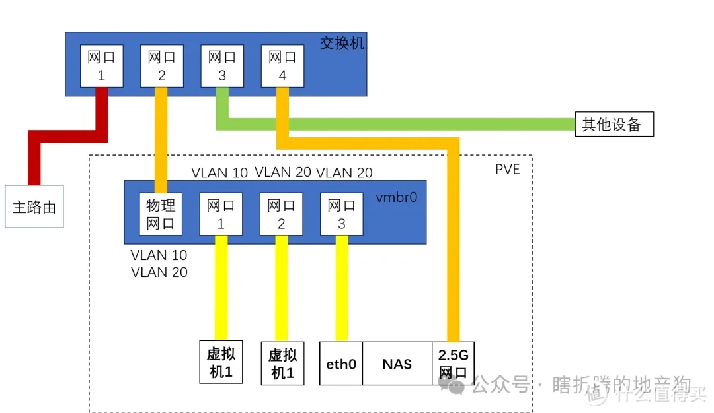
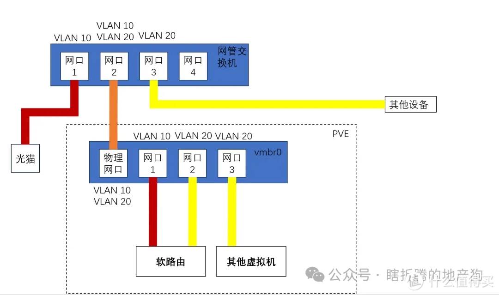

## 安装 PVE 系统

### 1. 制作启动盘

参照 [制作 U 盘启动盘](./制作U盘启动盘.md)

### 2. 下载 PVE 系统镜像

下载后放入 U 盘启动盘内。

### 3. 安装 PVE 系统

1. 插入启动盘，开机 进入 BIOS，选择 U 盘启动。
2. 选择安装 Proxmox VE。
3. 安装过程中，留意以下几点：
   - 选择安装位置: 不要选择 U 盘
   - 设置 locale: 选择 China, 时区选择 Asia/Shanghai, 键盘选择 US
   - 设置密码: 该密码对应于 root 用户
   - 设置主机名: 例如 `pve.localmachine`
   - 设置 DNS: 例如阿里云公共 DNS `223.5.5.5`
   - 设置邮箱
   - 设置网络:
     - 选择网卡 (我选择了 ***eth0***)
     - 如果接入了网络，自动会填入当前的 IP、网关、掩码等信息
     - 否则，手动设置。该 IP 会作为 PVE 的管理 IP

### 4. 安装成功后的操作

#### 如何连接到 PVE

管理页面 URL: `https://<IP>:8006/`

在管理页面的登录界面，输入用户名 `root` 和密码。

在管理页面的 shell 界面可以登录到终端。

#### 配置的 IP 并非有效的局域网 IP, 怎么办

方法 1: 电脑使用网线直连管理网口，设置电脑的网口 IP 与管理网口 IP 在同一网段，然后通过浏览器可以访问管理页面。
方法 2: 主机连接显示器，键盘，直接在主机上登录。

上述方法登录后，修改 web 管理 IP。

#### 如何修改 web 管理 IP

修改以下几处

1. `vi /etc/network/interfaces`
2. `vi /etc/hosts`
3. `vi /etc/issue`

然后执行 `reboot` 命令，重启 PVE。

#### 如何关机

```sh
shutdown -h now
```

#### 更新源

软件源配置和系统更新统一参见下文 [升级 PVE 系统](#5-升级-pve-系统)。

#### 设置网卡

> [PVE 系列之一：网口桥接或直通](https://www.cnblogs.com/Yogile/p/17862514.html)

安装 `ethtool` (我用的版本已经自带了)

```sh
apt install ethtool -y
```

我们希望检查和确认如下的**网卡配置**:

认知名 | 系统设备名 | 设备位置 (bus-info) | 软路由设备名
-----|--------|--------------|------------
Eth0 | enp2s0 | 0000:02:00.0 | Eth0（桥接）
Eth1 | enp3s0 | 0000:03:00.0 | Eth1
Eth2 | enp4s0 | 0000:04:00.0 | Eth2
Eth3 | enp5s0 | 0000:05:00.0 | Eth3

##### 检查网卡

```sh
# 查看网卡信息 `ethtool -i [系统设备名]`
ethtool -i enp2s0
# 遍历所有网卡
lspci | grep -i 'eth'
```

##### 检查网口和 Ethx 的对应关系

在 PVE 网页端，将除 Eth3 以外的 3 个网卡设置为自动启动。

###### 1) 使用闪光确认

```sh
ethtool -p [系统设备名]
```

如果显示:

```sh
Cannot identify NIC: Operation not supported
```

说明系统不支持闪光，需要用下述方法一个个试。

###### 2) 使用网线确认

逐个网口插入网线，执行如下命令，观察命令输出:

```sh
ethtool [系统设备名]
```

显示：

- "Speed: Unknown! Duplex: Unknown! (255)" 则为未连接网线；
- "Speed: 2500Mb/s Duplex: Full" 则为已连接网线

网卡配置表格确认后，在 PVE 网页端，将除 Eth3 以外的 3 个网卡 取消 自动启动。

拔掉所有除管理口以外的网线。

##### 设置硬件直通

编辑 grub 配置文件 `/etc/default/grub`

注释掉原条目，并新增一条:

```sh
# GRUB_CMDLINE_LINUX_DEFAULT="quiet"
GRUB_CMDLINE_LINUX_DEFAULT="quiet intel_iommu=on"
```

执行 `update-grub` 更新 grub 配置。

然后重启 PVE。(`reboot`)

### 5. 升级 PVE 系统

本文当前环境为 **PVE 8.3.0**。本节只介绍更新到所配置官方软件源提供的最新 **PVE 8.x**，不涉及升级到 PVE 9。以下按单节点环境说明，命令均以 root 在 **PVE 宿主机**执行，不在 VM 或 LXC 内执行。

PVE 8 基于 Debian 12 Bookworm。同系列更新时保留 `bookworm` 软件源，不改成 `trixie`，也不使用会随 Debian 发行版变化的 `stable`。

#### 5.1 升级前准备

- 备份重要 VM 和 LXC，并确认备份能从独立存储访问。快照不能替代备份。
- 保存宿主机的网络、存储和软件源配置，例如 `/etc/network/interfaces`、`/etc/hosts`、`/etc/pve/` 和 `/etc/apt/`。
- 预留维护和重启时间。如果 iKuai / OpenWrt 运行在 PVE 内，重启会造成网络中断，提前准备直连管理口或本地显示器、键盘。
- 若使用集群或 Ceph，需要额外安排节点维护顺序、迁移和集群健康检查，不能直接照搬单节点重启步骤。

记录版本、磁盘空间和被锁定的软件包：

```sh
pveversion -v
uname -r
df -h / /boot
apt-mark showhold
```

若磁盘空间不足，或关键 PVE 软件包被锁定，先查明原因再更新。

#### 5.2 检查软件源

在 PVE 管理页面中，进入 **节点 → Updates（更新）→ Repositories（软件源）**，检查启用的仓库。

| 类型 | PVE 8 使用的配置 |
| --- | --- |
| Debian 基础源 | bookworm |
| Debian 更新源 | bookworm-updates |
| Debian 安全源 | bookworm-security |
| 有有效订阅的 PVE 源 | pve-enterprise |
| 无订阅的家庭环境 PVE 源 | pve-no-subscription |

无有效订阅时，在界面中禁用 PVE Enterprise 源，再通过 **Add** 添加 **No-Subscription** 源。已有相同源时不要重复添加。

PVE 8 的 No-Subscription 源内容如下；手动配置时可放在 `/etc/apt/sources.list.d/pve-no-subscription.list`：

```text
deb http://download.proxmox.com/debian/pve bookworm pve-no-subscription
```

仅禁用 Enterprise 源而不添加可用的 PVE 源，会导致 PVE 软件包无法正常获取更新。Debian 基础源和安全源也需要保留。

如果 `/etc/apt/sources.list.d/ceph.list` 中还有 Enterprise 源，无订阅时可能出现 `401 Unauthorized`。未使用 Ceph 时可禁用该源；正在使用 Ceph 时应配置与当前 Ceph 版本匹配的可用仓库，不要随意切换版本。

参考：[Proxmox VE 8 官方管理指南](https://pve.proxmox.com/pve-docs-8/pve-admin-guide.pdf) 中的 Package Repositories。

#### 5.3 刷新并预览更新

```sh
apt update
```

先解决软件源报错，例如 `401 Unauthorized`、签名错误、DNS 解析失败或仓库不存在，再继续。

预览将要执行的更新，不实际安装：

```sh
apt -s dist-upgrade
```

检查准备安装、升级和移除的软件包。若计划移除 `proxmox-ve`，先停止并排查软件源和依赖；其他软件包的移除也应结合列表确认原因。

#### 5.4 执行升级

建议在本地控制台执行，或通过 SSH 在已安装的 `tmux` / `screen` 会话中执行，以便连接中断后重新进入会话。

```sh
apt dist-upgrade
```

使用 `dist-upgrade` 处理完整的依赖变化，不仅执行 `apt upgrade`。不加 `-y`，保留查看变更和处理配置文件提示的机会。

遇到配置文件替换提示时，先查看差异，结合自己的修改决定保留还是替换，不要一律覆盖。等待升级完成并确认没有安装错误后，再安排重启。

#### 5.5 重启并验证

在维护窗口内正常关闭重要 VM / LXC，并确认需要的开机自启及启动顺序，然后重启宿主机：

```sh
reboot
```

重新连接后检查：

```sh
pveversion -v
uname -r
systemctl --failed
pvesm status
qm list
pct list
apt policy pve-container
```

确认管理页面可访问、存储在线、网络正常，重要 VM / LXC 已启动且服务可用。

如果更新是为了解决 Debian 13 LXC 的 `unsupported debian version` 问题，需要关注 `pve-container` 软件包版本。完整更新后，再重新尝试创建容器；不要修改宿主机的版本检查代码来绕过限制。Community Scripts 对此问题也建议更新宿主机软件包，参见 [官方排障说明](https://community-scripts.org/docs/guides/troubleshooting#unsupported-proxmox-ve-version)。

以上为操作流程，尚未记录本机实际升级结果。完成后可补充升级日期、升级前后版本及验证情况。

### 6. FAQ

#### 什么是虚拟网桥

虚拟网桥的作用是给 PVE 系统内的虚拟机设置虚拟网口连接用的，虽然叫网桥，我们可以把他想象成只有 0-N 个物理接口以及很多个内部虚拟接口的交换机，如下图所示。



#### 一些虚拟机网络结构的例子

##### 案例 1



2.5G 网卡直通 NAS，其他的虚拟机全部接到 PVE 管理 IP 对应的网桥上。
为了虚拟机内的存储挂载读写速度 NAS 也有一个虚拟网口和虚拟网桥连接，然后两个网口接到交换机上去，整体比较简单。

##### 案例 2



全 PVE 设备总共就一个网口还需要将主路由也放在 PVE 内。
不推荐这种接法，因为所有流量都走这一条网线而且还有主路由，网络不稳定性比较大，容易 boom。
这里只是拿这个举例子什么是 VLAN。

图上红色的网线就是路由器 WAN 口的连接，黄色的就是局域网内的连接，橙色的线就是既要负责 WAN 口也要负责 LAN 口的线。
我们通过将 WAN 口网线设计的网口 VLAN tag 设为 10，LAN 口的设为 20，交换机的网口 2 设为 Trunk 接口跑两个 VLAN tag，就可以实现单线复用在 PVE 主机只有一个网口的情况下运行主路由。
